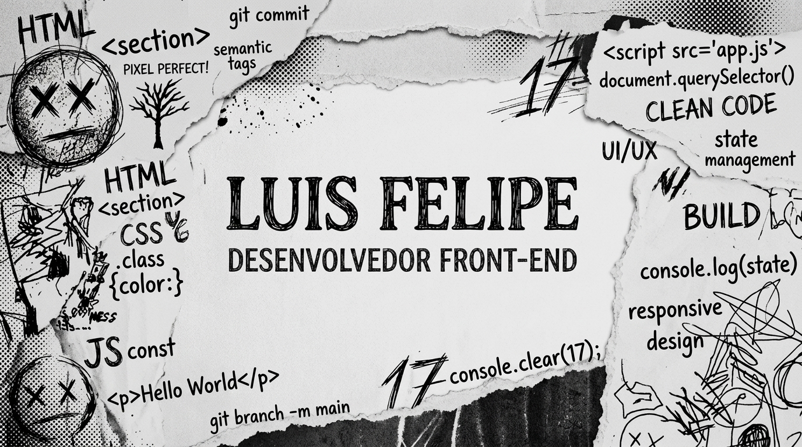
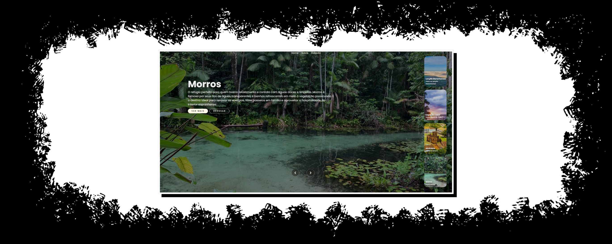

# Luis Felipe Reis

### Desenvolvedor Front-End · Estudante de Engenharia da Computação

Transformando ideias em aplicações úteis por meio da tecnologia, criatividade e aprendizado contínuo.

## Sobre mim

Olá! Sou Luis Felipe Reis, estudante de Ciência e Tecnologia, com ênfase em Engenharia da Computação, e tenho foco no desenvolvimento Front-End e em tecnologias web.

Atualmente, sou bolsista do programa Trilhas Frontend, onde busco aprimorar minhas habilidades técnicas, aprofundar meus conhecimentos em programação e desenvolver projetos que unam criatividade, tecnologia e utilidade.

Acredito no aprendizado contínuo, na prática como forma de evolução e no desenvolvimento de aplicações que resolvam problemas reais e proporcionem boas experiências aos usuários.

🎓 Graduando em Ciência e Tecnologia, com ênfase em Engenharia da Computação

💻 Focado em desenvolvimento Front-End e tecnologias web

🚀 Bolsista do programa Trilhas Frontend

🌱 Sempre aprendendo e aprimorando minhas habilidades em programação

🎯 Buscando desenvolver aplicações úteis, intuitivas e acessíveis

### Desenvolvimento

### Ferramentas e Plataformas

### Objetivos de desenvolvimento

Criar interfaces web responsivas, intuitivas e acessíveis.

Aprimorar meus conhecimentos em JavaScript e desenvolvimento Front-End.

Desenvolver projetos práticos para aplicar os conhecimentos adquiridos.

Explorar novas tecnologias e boas práticas de desenvolvimento de software.

Criar soluções digitais que sejam úteis e façam a diferença na vida das pessoas.

### Projetos em destaque

Estou construindo minha jornada na programação por meio de estudos, experimentos e projetos práticos.

### 🌴 Slider Turístico

  

<samp>FRONT-END · INTERACTIVE DESIGN</samp>

Uma experiência visual para explorar destinos turísticos por meio de um slider interativo, trabalhando apresentação de imagens, navegação e adaptação para diferentes tamanhos de tela.

 

### ⚖️ Calculadora de Peso Ideal

  

<samp>JAVASCRIPT · FORMULÁRIOS · LÓGICA</samp>

  

Aplicação web interativa criada para praticar entrada de dados, manipulação de elementos e lógica de programação com JavaScript.

 

---

### Let's connect

I'm always open to exchanging ideas about data, technology and learning.

